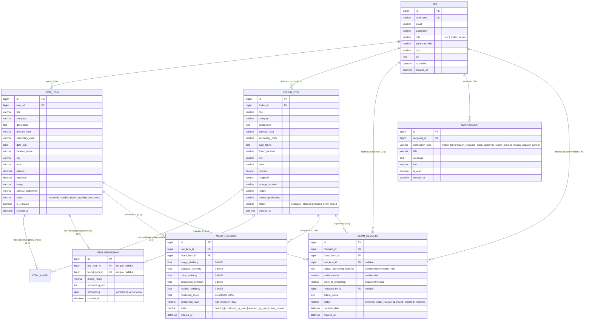

# Entity-Relationship (ER) Diagram & Database Schema

## SMART LOST & FOUND PLATFORM - MySQL Relational Architecture

The application is structured into normalized relational tables managed via Django ORM and persisted in MySQL 8.4 (`lost_found_db`).

---

## Relational Constraints and Optimization

1. **Composite Unique Constraint**:
   - `MatchRecord(lost_item_id, found_item_id)`: Prevents duplicate match records for the same pair of items while allowing scores to be updated dynamically when models re-evaluate.
2. **Confidentiality & Privacy Enforcements**:
   - `ClaimRequest.unique_identifying_features` and `serial_number` are strictly masked for unauthenticated or non-participating users in the REST serializer (`to_representation`).
   - Exact user coordinates on map popups are sanitized so personal residence landmarks are not exposed.
3. **Database Engine**:
   - MySQL 8.4 InnoDB engine with UTF8MB4 charset, foreign key integrity constraints, and cascade deletion rules for dependent child entities.
